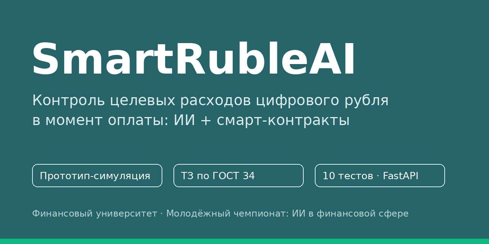
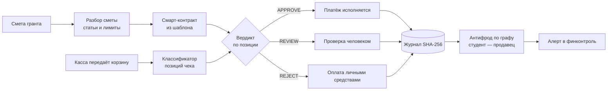
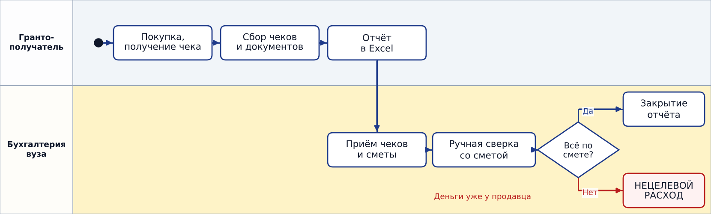
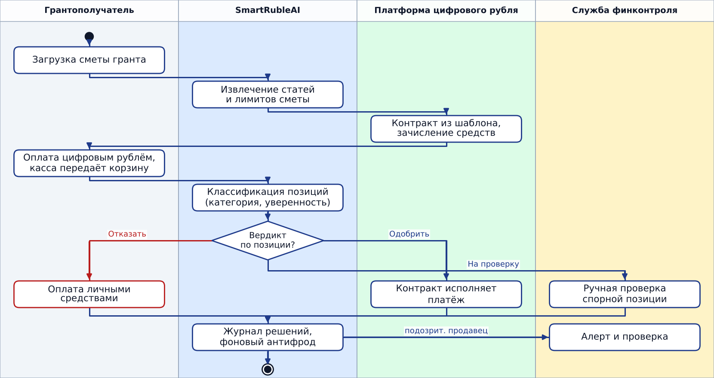
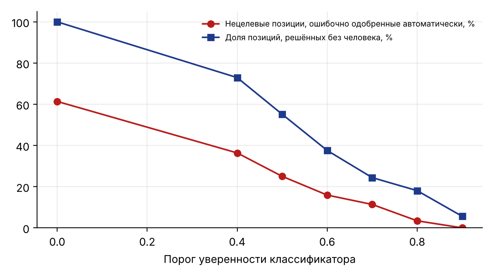

<div align="center">



### Контроль целевых расходов цифрового рубля **в момент оплаты**, а не после


[**Идея**](#-идея-за-30-секунд) · [**Как работает**](#-как-это-работает) · [**Демо**](#-демо-ответ-api) · [**Результаты**](#-результаты-честно) · [**Запуск**](#-быстрый-старт) · [**Документы**](#-документы) · [**Команда**](#-команда)

</div>

> **Честно о статусе.** Это **прототип-симуляция**. Интеграции с платформой цифрового рубля Банка России нет, все данные синтетические, реальные чеки и персональные данные не использовались. Слабые места системы названы и измерены ниже.

---

## 💡 Идея за 30 секунд

Сегодня целевые деньги (грант, подотчёт, целевая выплата) проверяют **после траты**: бухгалтерия вручную сверяет чеки со сметой, а нецелевой расход обнаруживается, когда деньги уже у продавца.

**SmartRubleAI переносит проверку в момент оплаты.** Смета превращается в лимиты смарт-контракта, а ИИ решает по **каждой позиции чека**:

| Решение | Что происходит |
|---|---|
| ✅ `APPROVE` | позиция соответствует статье сметы, оплачивается из целевых средств |
| 🟡 `REVIEW` | модель не уверена, решение за человеком |
| ⛔ `REJECT` | позиция не относится к целям, оплачивается личными средствами |

Один чек может быть разделён: часть одобрена, часть уходит на личные деньги, всё пишется в журнал.

## 🧩 Как это работает



Четыре контура:

1. **Разбор сметы** (`parser.py`). В продукте здесь языковая модель, но она **только извлекает параметры**. Код контракта ИИ не пишет, он собирается из проверенного шаблона.
2. **Проверка позиций** (`classifier.py`, `contract.py`). Классификатор TF-IDF + логистическая регрессия, порог уверенности управляет риском.
3. **Антифрод** (`antifraud.py`). Граф «студент — продавец» (NetworkX), признаки продавцов, Isolation Forest.
4. **Журнал аудита** (`contract.py`). Цепочка хэшей SHA-256: подмена записи обнаруживается.

> Корзину для проверки передаёт **касса или эквайринг до списания**: чек в ОФД формируется только после платежа.

<details>
<summary><b>Процессы AS IS и TO BE (диаграммы деятельности)</b></summary>

**AS IS: проверка после траты**


**TO BE: контроль встроен в платёж**


Исходники PlantUML лежат в `docs/uml/`.
</details>

## 🎬 Демо: ответ API

Чек из двух позиций (плата Arduino и шоколад), смета с лимитом на расходные материалы:

```json
{
  "status": "PARTIAL",
  "approved": 2500,
  "personal_pay": 240,
  "items": [
    { "name": "Микроконтроллер Arduino Uno R3", "decision": "APPROVE",
      "category": "consumables", "confidence": 0.881, "reason": "соответствует статье сметы" },
    { "name": "Шоколад Аленка молочный", "decision": "REJECT",
      "category": "other", "confidence": 0.854, "reason": "позиция не относится к целям средств" }
  ]
}
```

Это результат реального вызова `POST /contracts/{grant_id}/validate` в Swagger UI (код 200).

## 📊 Результаты (честно)

Эксперимент на синтетических данных (1 500 позиций, 5 категорий):

| Показатель | Значение |
|---|---|
| Точность на типах товаров, которых модель **не видела** | около **45%** |
| Порог уверенности 0,8: нецелевых позиций одобрено автоматически | **3,4%** |
| Порог 0,8: позиций решено без человека | **18%** |
| Антифрод: заложенных схем найдено (20 прогонов по 4 схемы) | **4 из 4** в каждом прогоне |

<div align="center">

</div>

**Как читать.** Чем выше порог, тем меньше ошибочных одобрений, но тем больше работы человеку. Словарная модель слабо обобщается на новые товары, поэтому в продукте нужны эмбеддинги или языковая модель, обучение на данных пилота и ручная проверка спорных случаев. Это поведение системы на искусственных данных, а не точность на реальных чеках. Точные значения: [`docs/metrics.json`](docs/metrics.json).

## 🚀 Быстрый старт

Нужен Python 3.11 или новее.

```bash
git clone https://github.com/VenuK0/smart-ruble-ai.git
cd smart-ruble-ai
python -m venv .venv && source .venv/bin/activate     # Windows: .venv\Scripts\activate
pip install -r requirements.txt

python -m unittest discover -s tests -v               # 10 тестов
cd src && python -m smartruble                        # метрики и график
cd .. && uvicorn smartruble.api:app --app-dir src     # API и Swagger: http://127.0.0.1:8000/docs
```

<details>
<summary><b>Пример запросов к API</b></summary>

```bash
curl -X POST http://127.0.0.1:8000/contracts -H "Content-Type: application/json" \
  -d '{"grant_id":"g1","text":"Расходные материалы — 50 000 ₽\nОборудование — 120 000 ₽"}'

curl -X POST http://127.0.0.1:8000/contracts/g1/validate -H "Content-Type: application/json" \
  -d '{"merchant":"ООО Электроника","items":[{"name":"Микроконтроллер Arduino Uno R3","price":2500},{"name":"Шоколад Аленка молочный","price":240}]}'

curl http://127.0.0.1:8000/contracts/g1/audit
```

Первый запуск scikit-learn может занять несколько секунд.
</details>

## 🗂 Структура

```
src/smartruble/   ядро: parser, classifier, contract, antifraud, data, experiment, api
tests/            10 автоматических тестов (unittest, совместимы с pytest)
docs/
├── TZ_SmartRubleAI_GOST34.pdf / .docx   техническое задание по ГОСТ 34.602-89
├── uml/                                 диаграммы AS IS и TO BE (PNG + PlantUML)
├── presentation/                        презентация и карточка проекта
└── metrics.json, threshold_tradeoff.png результаты эксперимента
```

## 📚 Документы

| Документ | Что внутри |
|---|---|
| [Техническое задание (PDF)](docs/TZ_SmartRubleAI_GOST34.pdf) · [DOCX](docs/TZ_SmartRubleAI_GOST34.docx) | требования по ГОСТ 34.602-89 |
| [Процесс AS IS](docs/uml/as_is_activity.png) · [Процесс TO BE](docs/uml/to_be_activity.png) | диаграммы деятельности |
| [Метрики эксперимента](docs/metrics.json) | точные значения |

## 🛣 Развитие

| Срок | Что делаем |
|---|---|
| 0–3 мес. | MVP-симуляция и пилот на обезличенных данных вуза |
| 3–9 мес. | обучение на данных пилота, эмбеддинги вместо словарной модели, тестовый контур платформы ЦБ при открытии доступа |
| 9–18 мес. | масштаб: гранты и субсидии, подотчётные средства, целевые студенческие выплаты; интеграция с 1С и ЭДО вуза |

## ⚠️ Ограничения и риски

- Доступ к платформе смарт-контрактов определяет оператор (Банк России), поэтому контракт в прототипе имитируется.
- Качество на реальных чеках не измерено.
- Данные чеков требуют обезличивания и юридической проверки (ФЗ-152).
- Ядро покрыто тестами, API проверен вручную через Swagger UI; автоматических тестов на API пока нет.

## 👥 Команда

| | |
|---|---|
| **Окунев Владислав Игоревич** | студент направления «Бизнес-информатика» |
| **Штунь Анастасия Романовна** | студентка направления «Бизнес-информатика» |
| **Рзун Ирина Геннадьевна** | научный руководитель, доцент кафедры «Информатика, математика и общегуманитарные науки» |

Новороссийский филиал Финансового университета при Правительстве РФ. Проект молодёжного чемпионата «Практическое применение цифровых технологий для задач финансовой отрасли» (тема 2026 года: «Применение искусственного интеллекта в финансовой сфере»).

## 📄 Лицензия

MIT, см. [LICENSE](LICENSE).
