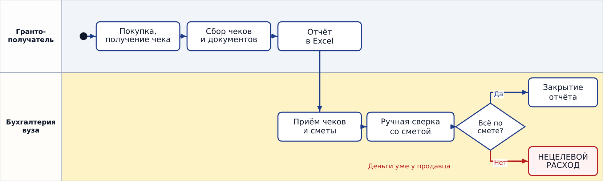
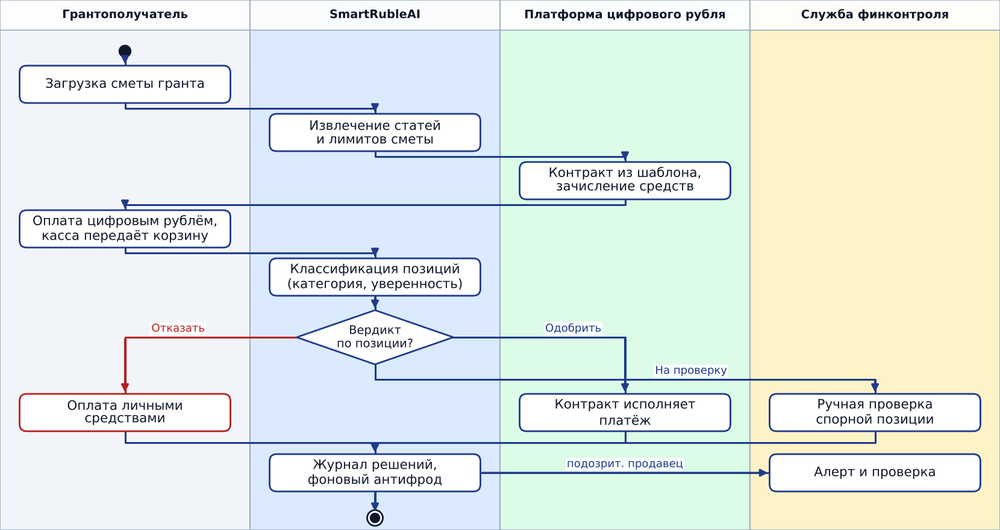

**ИИ-классификация · правила расходования · проверяемый журнал · анализ аномалий**

[**Демонстрация**](#демонстрация) · [**Возможности**](#что-умеет-прототип) · [**Результаты**](#эксперименты-и-ограничения) · [**Установка**](#локальный-запуск) · [**Документация**](#документация) · [**Команда**](#команда)

> [!IMPORTANT]
> **СмартРубль AI (SmartRubleAI) — исследовательский прототип-симуляция.** Он **не подключён** к платформе цифрового рубля Банка России, не осуществляет реальные платежи, не использует настоящие чеки и персональные финансовые данные. Все операции и ML-эксперименты моделируются. Приложение **не предназначено для публичной эксплуатации**: в нём пока нет авторизации и постоянного хранилища.

## Проблема и решение

При работе с целевыми средствами грантов и программ поддержки проверка чеков зачастую происходит уже **после покупки**. Возможные нецелевые расходы выявляются при отчётности, когда платёж уже проведён.

**Идея SmartRubleAI:** анализировать состав покупки по отдельным позициям и условиям сметы *до* условного списания целевых средств. Это **проектируемый процесс TO BE**, а не заявление о наличии банковской интеграции.

| Решение | Значение в симуляции |
|:--|:--|
| **APPROVE** | Позиция распознана как допустимая и укладывается в лимит |
| **REVIEW** | Недостаточно уверенности / категория не предусмотрена; нужен человек |
| **REJECT** | Нецелевая позиция или превышение разрешённого лимита |

Система сохраняет решения в журнале с цепочкой хэшей, отдельно позволяет исследовать аномалии в синтетических транзакциях.

## Демонстрация

**Название интерфейса:** «СмартРубль AI». [Логотип и правила фирменного стиля](docs/BRAND_GUIDE.md). Техническое имя репозитория и пакета остаётся SmartRubleAI.

Встроенный интерфейс — **рабочее место финансового контроля**: отдельные разделы, таблицы и формы, подключённые к FastAPI. Теперь стартовый экран объясняет порядок действий при пустой системе, реестр смет позволяет искать и быстро выбирать активную смету, а показатели освоения лимитов рассчитываются по данным API.

| Адрес после запуска | Возможности |
|:--|:--|
| **http://127.0.0.1:8000/app** | Главная, сметы, проверка чеков, история, антифрод, экономическая оценка |
| **http://127.0.0.1:8000/docs** | Swagger / OpenAPI с запросами и ответами |
| **http://127.0.0.1:8000/health** | Проверка состояния API |

**Экспорт для Excel:** на страницах «Сметы и лимиты» и «История операций» есть кнопки **«Экспорт CSV»**. Выгружаются отображаемые строки с учётом фильтра; разделитель — `;`, кодировка — UTF-8 c BOM. Экспорт не изменяет данные на сервере. История API ограничена последними 100 записями выбранной сметы, поэтому выгрузка не является архивом всей деятельности.

**Рекомендуемый показ для жюри:** создать пример сметы → проверить чек с целевыми и нецелевыми товарами → показать лимиты и журнал → запустить синтетический анализ аномалий → объяснить сценарный экономический расчёт. Детальный тайминг в [DEMO_RUNBOOK.md](docs/DEMO_RUNBOOK.md).

## Что умеет прототип

| Модуль | Реализовано сейчас | Ограничения |
|:--|:--|:--|
| **Разбор сметы** | Извлечение категорий и лимитов из текста по правилам | Языковая модель пока **не подключена** |
| **Классификация** | TF-IDF (символьные n-граммы) + логистическая регрессия, пороги уверенности | Обучение и тесты на синтетических наименованиях |
| **Условная проверка чеков** | Лимиты, проверки сумм, идемпотентность ID чека, ручная проверка неопределённых позиций | Нет подключения к оплате и БД |
| **Аудит** | Проверка целостности локальной цепочки SHA-256, включая временные метки | Нет внешней подписи/доверенного якоря |
| **Антифрод** | NetworkX + Isolation Forest, отдельное API-демо на синтетике | Пока **не встроен** в основной процесс оплаты |
| **Экономический сценарий** | Изменяемые допущения и расчёт эффекта/окупаемости | Не результаты пилотного внедрения |
| **Тестирование** | Проверки ядра, API, финансовых инвариантов и сценариев в GitHub Actions | Не заменяет аудит безопасности |

### Архитектурная концепция

<i>AS IS — сверка после расходов</i>

<i>TO BE — планируемый процесс контроля</i>

Диаграммы описывают целевую архитектуру. Некоторые изображённые интеграции отсутствуют в текущем коде. Исходники: [docs/uml](docs/uml).

### Оформление

Рабочая область выполнена в фирменной палитре **Graphite Red**, с единой светлой темой. Боковое меню сгруппировано по назначению: **«Работа со средствами»** и **«Аналитика»**. На компьютере меню можно свернуть до иконок кнопкой рядом с заголовком; выбор сохраняется в браузере. Навигация использует настоящие адреса `/app/...`, а иконки в компактной версии снабжены подсказками и доступными названиями. На телефоне меню всегда отображается с текстовыми подписями и закрывается нажатием вне панели или клавишей Esc.

Текущий статус: **v0.3.0-dev**, до публикации стабильного релиза нужны визуальная проверка на ПК и мобильном устройстве и обратная связь команды. Демонстрация по-прежнему не обрабатывает реальные платежи.

## Локальный запуск

**Требования:** Python 3.11+, доступ к PyPI при установке. Открывать приложение только локально.

~~~bash
git clone https://github.com/VenuK0/smart-ruble-ai.git
cd smart-ruble-ai

python -m venv .venv
~~~

**Windows PowerShell:**

~~~powershell
.\.venv\Scripts\Activate.ps1
python -m pip install -r requirements-dev.txt
python -m unittest discover -s tests -v
python -m uvicorn smartruble.api:app --app-dir src --host 127.0.0.1 --port 8000
~~~

**Linux / macOS:**

~~~bash
source .venv/bin/activate
python -m pip install -r requirements-dev.txt
python -m unittest discover -s tests -v
python -m uvicorn smartruble.api:app --app-dir src --host 127.0.0.1 --port 8000
~~~

После запуска откройте **http://127.0.0.1:8000/app**. Старый URL `/demo` пока работает для обратной совместимости. Первый запуск API может обучать классификатор несколько секунд. Состояние контрактов хранится **в оперативной памяти** и сбрасывается при перезапуске. Для нового демонстрационного прогона создавайте уникальный ID сметы.

<b>Пример HTTP-запросов</b>

Создать смету:

~~~bash
curl -X POST http://127.0.0.1:8000/contracts -H "Content-Type: application/json" \
  -d '{"grant_id":"g1","text":"Расходные материалы — 50 000 ₽\nОборудование — 120 000 ₽"}'
~~~

Проверить чек:

~~~bash
curl -X POST http://127.0.0.1:8000/contracts/g1/validate -H "Content-Type: application/json" \
  -d '{"id":"receipt-demo-1","merchant":"ООО Электроника","items":[{"name":"Микроконтроллер Arduino Uno R3","price":2500},{"name":"Шоколад Аленка молочный","price":240}]}'
~~~

Получить журнал: http://127.0.0.1:8000/contracts/g1/audit

> В Windows PowerShell удобнее использовать Swagger UI в /docs: кавычки и переносы команд curl отличаются от bash.

## Эксперименты и ограничения

Измерения выполнены **только на искусственно созданных данных**.

| Показатель | Зафиксированный результат |
|:--|--:|
| Классификация знакомых типов товаров (исходный эксперимент) | 100% |
| Классификация новых базовых типов (исходный эксперимент) | **44,88%** |
| Классификация новых базовых типов, 12 независимых seed (среднее) | **47,26%** |
| Диапазон точности на новых типах, 12 seed | **35,56–53,01%** |
| Доля искусственно заложенных аномалий в топ-4 (исходные данные) | 100% |
| То же после маскировки сумм и времени операций | **81,25%** |

**Интерпретация:** модель пока недостаточно надёжна для самостоятельного разрешения реальных покупок. Уверенность классификатора не является гарантией правильного решения; результаты антифрода нельзя переносить на настоящие случаи мошенничества. Смотрите [методику устойчивости](docs/ROBUSTNESS.md), [исходные метрики](docs/metrics.json) и [ограничения безопасности](docs/SECURITY_LIMITATIONS.md).

Экономический калькулятор показывает, при каких **предположениях** система может дать положительный эффект. Условный сценарий не является доказательством снижения затрат. Подробнее в [ECONOMIC_MODEL.md](docs/ECONOMIC_MODEL.md).

## Структура

~~~text
smart-ruble-ai/
├── src/smartruble/
│   ├── api.py              FastAPI и REST-маршруты
│   ├── web/                HTML, CSS и JS рабочего пространства
│   ├── parser.py           разбор сметы по правилам
│   ├── classifier.py       ML-классификатор товаров
│   ├── contract.py         лимиты, проверка и аудит
│   ├── antifraud.py        графовый антифрод
│   ├── economics.py        сценарный расчёт эффекта
│   ├── robustness.py       воспроизводимый стресс-тест
│   └── experiment.py       исходные ML-эксперименты
├── tests/                  unit + integration + safety
├── docs/                   ТЗ, UML, исследования и материалы защиты
├── .github/workflows/      автоматическая проверка
├── CHANGELOG.md            история версий
└── LICENSE                 MIT
~~~

## Документация

**Версии:** [v0.2.0-rc.2 — текущая предварительная](https://github.com/VenuK0/smart-ruble-ai/releases/tag/v0.2.0-rc.2) · [v0.2.0-rc.1 — предыдущая](https://github.com/VenuK0/smart-ruble-ai/releases/tag/v0.2.0-rc.1) · [v0.1.0 — исходная конкурсная](https://github.com/VenuK0/smart-ruble-ai/releases/tag/v0.1.0). Сообщения об ошибках и предложения: [Issues](https://github.com/VenuK0/smart-ruble-ai/issues). Подробнее о развитии: [CONTRIBUTING.md](CONTRIBUTING.md).

| Материал | Назначение |
|:--|:--|
| [Техническое задание — PDF](docs/TZ_SmartRubleAI_GOST34.pdf) · [DOCX](docs/TZ_SmartRubleAI_GOST34.docx) | Первоначальное конкурсное ТЗ; может содержать планируемые компоненты |
| [Сценарий демонстрации](docs/DEMO_RUNBOOK.md) | Пятиминутное выступление, команды и ответы на вопросы |
| [Исследование устойчивости](docs/ROBUSTNESS.md) | Методика, результаты на 12 seed, ограничения |
| [Экономическая модель](docs/ECONOMIC_MODEL.md) | Формулы, вводные предположения, сценарии |
| [Ограничения безопасности](docs/SECURITY_LIMITATIONS.md) | Реализованные проверки и непокрытые риски |
| [История версий](CHANGELOG.md) | Развитие после первой конкурсной версии |
| [Исходный конкурсный выпуск v0.1.0](https://github.com/VenuK0/smart-ruble-ai/releases/tag/v0.1.0) | Снимок отправленной на первый тур версии |

## План развития

1. **Демонстрационный прототип:** безопасность ввода, удобное демо, тестирование, воспроизводимые эксперименты.
2. **Исследовательский пилот:** больше данных, улучшение качества классификации, исследование ошибок, роли, БД и контрольный контур.
3. **Интеграционный этап:** проверка правовой и технической возможности работы с платёжной инфраструктурой, 1С и ЭДО. Наличие доступа не гарантировано.

## Команда

| Участник | Роль |
|:--|:--|
| **Окунев Владислав Игоревич** | соавтор |
| **Штунь Анастасия Романовна** | соавтор |
| **Рзун Ирина Геннадьевна** | научный руководитель |

Новороссийский филиал Финансового университета при Правительстве РФ. Исходный проект подготовлен для молодёжного чемпионата «Практическое применение цифровых технологий для задач финансовой отрасли» (тематика 2026 года — ИИ в финансах).

**Лицензия:** [MIT](LICENSE). Оба автора указаны в лицензии и документации.
